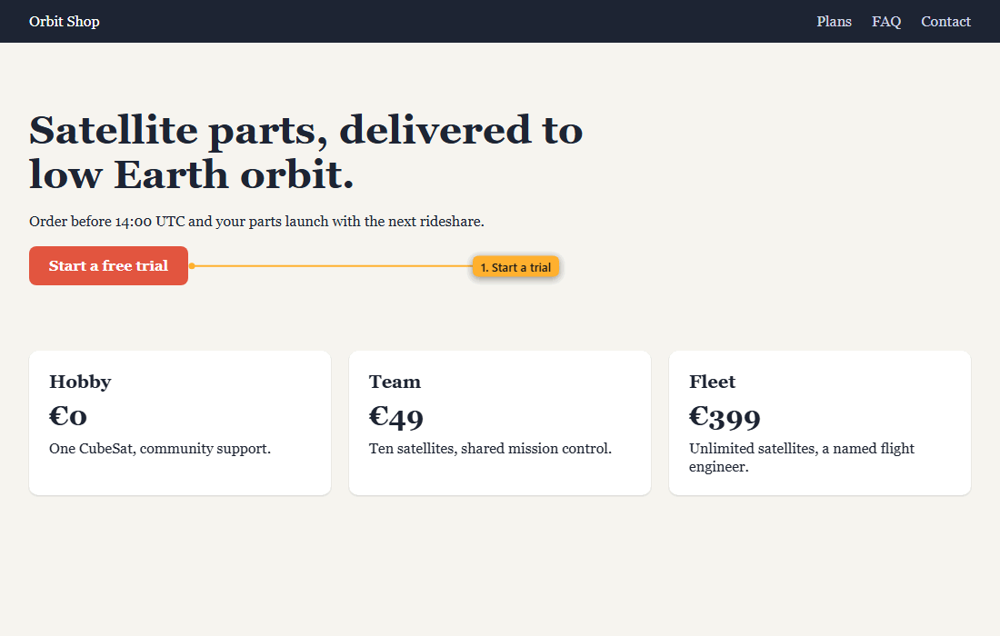
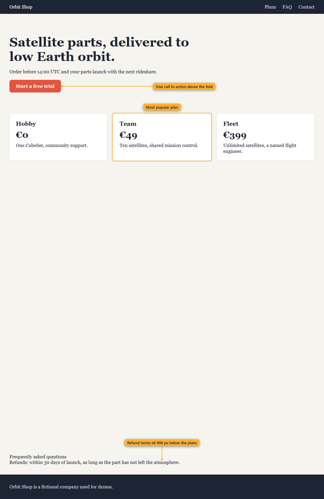

# annotated-screenshots

Annotated screenshots, demo GIFs and screen recordings of websites and VS Code extensions, made with [Playwright](https://playwright.dev). Callouts and markers attach to elements on the page, not to coordinates. After a UI change, rerun the script and they still point at the right things.



It ships as a [Claude Code](https://claude.com/claude-code) skill. Ask Claude for "a demo GIF of the sign-up flow" or "annotate this screenshot", and it copies the library into your project and writes the capture script. The library also works without Claude.

## What it does

- **Callouts, numbered markers and outlines**, attached to Playwright locators (or to fixed rectangles, for an image from elsewhere).
- **Two ways to draw them:**
  - **Onto a finished screenshot.** The page's CSS can't interfere, full-page captures work, and the original PNG stays untouched (useful when the screenshot is evidence).
  - **As a live overlay on the page.** Needed for video and for Electron apps.
- **Redaction**: an opaque fill over a locator or a fixed rectangle, under the callouts, in screenshots, GIFs and recordings. Not a blur or pixelation, which can sometimes be reversed. Drawn onto a finished screenshot, only the annotated output is safe to share: the untouched original still shows what the redaction covers, so don't publish it.
- **Demo GIFs** from a list of stills, with optional crossfades. Each frame stores only what changed. The finished GIF is decoded again and compared with its stills, because image viewers often show only its first frame.
- **Screen recordings** of any stretch of a session: a WebM with a pointer that follows the actions, or a GIF built from the recorded frames. See the caveats in [SKILL.md](skills/annotated-screenshots/SKILL.md#video-with-caveats).
- **VS Code extensions**: targets for editor lines and the gutter, and notes on driving a pinned VS Code build through Playwright's Electron support.



## Install as a Claude Code plugin

```
/plugin marketplace add FreHu/annotated-screenshots
/plugin install annotated-screenshots@annotated-screenshots
```

## Use without Claude

Copy the files you need from [`skills/annotated-screenshots/lib/`](skills/annotated-screenshots/lib/) into your project. They're plain ES modules with no build step. The GIF encoder needs `gifenc`. [`examples/website.mjs`](examples/website.mjs) shows the whole flow:

```js
const canvas = await openCanvasPage(context);
const measured = await measureAll(page, [
  { target: { locator: page.locator("#cta") }, text: "One call to action above the fold", labelX: 520 },
  { target: { locator: page.locator(".plan").nth(1) }, box: true, text: "Most popular plan", above: 8 },
], { fullPage: true });
const png = await page.screenshot({ fullPage: true });
writeFileSync("annotated.png", await annotateScreenshot(canvas, png, measured));
```

## Development

```
npm ci
npx playwright install chromium
npm test                       # checks positions by sampling pixels, not by comparing whole images
npm run example -- --video     # writes examples/out/
```

## License

MIT
